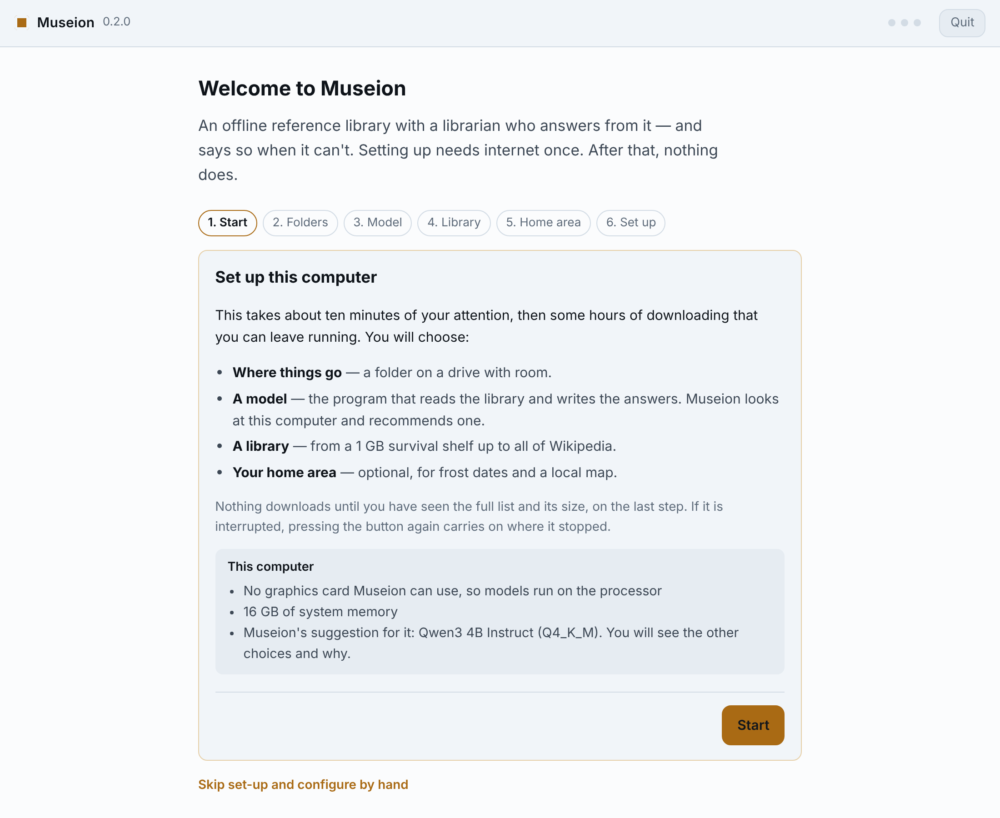

# Museion

**An offline knowledge library with a local AI assistant, for when the internet is gone.**

Museion is a program that keeps a curated reference library on your own disk — survival
and post-disaster guidance, medicine, practical making and repair, and general reference —
and runs a language model locally on top of it. You ask a question in plain language; it
finds the relevant pages in your library and answers **from them, with citations you can
open and read yourself**.

No internet. No account. No cloud. Nothing leaves the machine.

The assistant is called **Hypatia**, after the last great teacher of Alexandria. Museion is
the institution around her — named for the Alexandrian research establishment, which was
never merely a room full of scrolls but a place where scholars lived, taught, and answered
questions.

---

## Two things to be honest about up front

**1. Setting this up requires internet. Using it does not.**

The library is between 800 MB and 270 GB depending on how much you want. That cannot live
in a git repository. This repo ships *manifests* — verified checksums, mirrors, and torrent
links — and fetches content on first run. A preparedness tool you can only install *before*
the disaster is one most people won't have when it matters, so set it up now, and see
[docs/usb-prep.md](docs/usb-prep.md) for preparing a drive to carry to a machine that has
no connection at all.

**2. This is a reference library, not a guarantee.**

Museion does not contain everything you need to survive, and no honest project would claim
otherwise. It contains the best freely-licensed reference corpus that exists, made
searchable offline, with citations so you can judge the source yourself. Where the library
is silent, Hypatia is built to say so rather than invent something — see
[docs/safety.md](docs/safety.md).

---

## Download

No git, no installer, and no Python to install. Get the file for your system from the
[latest release](https://github.com/SeyelentEco/museion/releases/latest):

| System | File | Size |
|---|---|---|
| Windows 10 or 11 | `museion-<version>-windows.zip` | about 840 MB |
| macOS on Apple silicon | `museion-<version>-macos.zip` | about 120 MB |
| Linux, x86-64 | `museion-<version>-linux.tar.gz` | about 245 MB |

1. **Unpack it** somewhere with room for a library (1 GB to 270 GB) and a model (3 GB to
   37 GB): the computer's own disk, or a removable drive. It does not run from inside the
   zip.
2. **Start it**: double-click `Museion.cmd` on Windows or `Museion.command` on a Mac; on
   Linux run `./museion.sh`. Museion opens in your web browser.
3. **Set it up**: the page shows what it would fetch and how large each piece is, and
   fetches it when you say so. This is the only step that needs the internet.



The first start may meet a warning, because the download is not signed:

- **Windows** says "Windows protected your PC". Choose *More info*, then *Run anyway*.
- **macOS** refuses programs from an unsigned download. In Terminal, run
  `xattr -dr com.apple.quarantine` followed by the unpacked folder, once.

The Windows file is the largest because it carries a llama.cpp build for every kind of
graphics card, so the same folder works on the next computer too. Each file has a
checksum in `SHA256SUMS.txt` on the release page. [CHANGELOG.md](CHANGELOG.md) says what
each version changed.

### Upgrading

A newer download upgrades the copy you have, offline, without touching your library,
models, notes or settings, and carrying over changes you made to Museion's code. In
Settings › Version and upgrades, choose the newer download and press Upgrade; the version
you had is kept, so you can go back. A copy of version 0.1.0 has no such button: unpack
the newer download beside it and run `Museion.cmd upgrade --into` followed by the old
folder (`./museion.sh` or `Museion.command` elsewhere). [docs/upgrading.md](docs/upgrading.md)
explains all of it.

## From the source

Working end to end: fetch a library, index it, ask it questions, get cited answers. From
a copy of this repository all it needs is Python 3.11 or newer; it uses nothing outside
Python's standard library.

```bash
git clone https://github.com/SeyelentEco/museion
cd museion
python -m museion
```

That opens Museion in your web browser. On a machine that isn't set up, the page shows a
set-up wizard and nothing else. It looks at your hardware and walks through where things
go, which model to use (each one with whether it fits this computer and what it can and
cannot do, and one recommended), which library to start with and, optionally, your home
area. The last step lists exactly what it will fetch and how large each piece is; then it
downloads it all (resumable, verified), fits the model to your GPU, starts the services
and builds the index. Then it gets out of the way, leaving Ask, Agents, Notes, Map,
Library, Evals and Settings.

Everything the page does, the command line does too:

```bash
python -m museion tools --dest bin                         # kiwix-serve, llama-server, pdfium
python -m museion fetch go-bag --dest /path/to/library     # 822 MB, checked against upstream
python -m museion index --library /path/to/library --pdfium bin
python -m museion ask --library /path/to/library "how much bleach makes a gallon of water safe to drink?"
```

[docs/setup.md](docs/setup.md) goes through it step by step.

**What it answers like.** Asked about bleach dosing, it gives ¼ teaspoon per gallon [1],
notes the 16-drops alternative [4][5], and warns to use only unscented bleach, to filter
cloudy water first, and that bleach will not remove chemical pollutants — every claim
carrying a page-level citation into *Purifying Water During an Emergency*.

Asked for a 55-gallon drum instead, it searches, reads the dose, and hands the arithmetic
to a calculator — `convert(55 * 0.25, tsp, ml) = 67.77` — then shows that calculation
under the answer as ground truth. A language model multiplying in its head got that one
wrong by a factor of five before the calculator existed.

Every answer is labelled by what actually produced it: *from your library*, *from your
library, with calculation*, *computed*, or *general knowledge — not from your library,
unverified*. Asked what caused the Bronze Age collapse, it answers from general
knowledge under that last label; asked anything medical or safety-critical the library
doesn't hold, it says so and stops. See [docs/retrieval.md](docs/retrieval.md).

---

## For the long haul

Beyond answering questions, Museion keeps what one household needs to get through a long
time cut off, all in plain files on the same disk:

- **Your notes and records.** The Notes tab holds what you write down and the records
  the agents keep for you: stores, medicines, a health log, machines and their servicing,
  power, places, people. They are searched with the library, and an answer that rests on
  them says *from your own notes*. An agent changes one only after you press Allow on a
  card that shows the change. See [docs/notes.md](docs/notes.md).
- **Coming up, and an almanac.** The Notes tab opens on what to do now and in the next
  weeks: garden, preserving, animal and house tasks timed from your own frost dates, so
  they fit where you live, plus servicing that is due and medicines about to expire. The
  Garden planner answers "what should I be doing now?" from it. Don't know your frost
  dates? Set up **your home area** once (in Settings, or at the end of first-run set-up):
  Museion downloads the NOAA weather-station records around it and works out its frost
  dates and hardiness zone, for the almanac and the agents, with no internet after.
- **First steps.** Tell the First steps agent what happened (the grid is down; the power
  is on but the phones and internet are not; a long isolation; a flood) and it reads your
  records, works out what runs out first, asks the water planner, clinic and power keeper
  for their part, and saves a checklist for today, this week and this month.
- **Clinic and power.** The Clinic agent answers from the medical books with danger signs
  first and doses only from a passage it cites; the Power keeper works out what your
  panels, batteries or generator can run and when servicing is due.
- **Offline maps.** The Map tab shows a map of your area with the places you mark on it:
  water, shelter, medical help, danger. Museion makes the map itself from OpenStreetMap
  while the internet works (type a town, pick how far across), or shows one you made with
  QGIS. See [docs/maps.md](docs/maps.md).
- **A radio, if you have one.** With a Meshtastic radio plugged in, a Radio tab sends and
  receives short text messages with other radios nearby, no network needed, and keeps them
  in your notes. Optional, and so far tested only against simulated radios. See
  [docs/radio.md](docs/radio.md).

---

## Changing it, offline

Museion is written to be changed by the person who has it, years after the last
download, with no internet. It is plain Python in short files, each with comments that
say why. A prepared drive carries [opencode](https://opencode.ai), a coding agent, set up
to use the chat model on the same drive: double-click `Edit Museion` and say what you
want changed. [AGENTS.md](AGENTS.md) is what it reads first, and what a person should
read first too. With Qwen3.6 35B on a 12 GB graphics card it has added an archive to the
catalogue, added a rule to the assistant's instructions, and found and fixed a bug from
its symptom alone; the small 4B model cannot be relied on for this. See
[docs/python.md](docs/python.md).

---

## Design

Three local processes, no Docker, nothing to install:

```
┌─ Museion (Python standard library) ──────────────────────┐
│  the page in your browser · hardware detection           │
│  helper supervision · downloader · retrieval · chat      │
└──────────────┬──────────────────────┬────────────────────┘
               │                      │
     ┌─────────▼─────────┐  ┌─────────▼──────────────────┐
     │ kiwix-serve       │  │ llama-server (chat)        │
     │ ZIM content +     │  │ llama-server (reranker)    │
     │ full-text index   │  │ CUDA / Vulkan / Metal      │
     └───────────────────┘  └────────────────────────────┘
```

The heavy work is done by pinned native programs — llama.cpp, kiwix-serve, pdfium,
SQLite's FTS5 — fetched from their publishers and checked against the catalogue's
hashes. Python only drives them, so the part a person might want to change is the part
that is easy to read.

### Why there is no embedding step

Projects that embed every article chunk into a vector database before you can ask anything
spend hours per archive and two to three times the disk — and you still can't query until
it finishes. Museion doesn't do that.

Most ZIM archives already ship with a working **Xapian full-text index**, so Museion
searches the index that is already there and reranks the top candidates with a small
cross-encoder to fix keyword search's weakness at paraphrase. Those archives are queryable
the moment the download completes.

Some archives — notably everything built by web crawl, which includes the whole `zimgit-*`
series in the Go Bag — ship an index that is technically present but effectively empty. We
measured it: zero hits for *chlorine*, *bleach*, *wound* or *bowline* across the entire
bundle. For those, Museion builds a local SQLite FTS5 index at import: minutes for the Go
Bag, not the hours a vector database would cost. Which path an archive takes is detected
automatically.

[docs/retrieval.md](docs/retrieval.md) has the measurements and the reasoning.

### Why the fetcher looks the way it does

Kiwix publishes a `.sha256`, a `.magnet` and a `.torrent` beside every archive. So the
catalog carries **authentic upstream checksums for content nobody had to download**, and
the mirror list is harvested from the magnet's webseeds rather than guessed — eight
independent mirrors per file, including nluug.nl, dotsrc.org and mirror.download.kiwix.org.
If the main redirector is down or blocked, your library still downloads. That is the
entire point.

Downloads land in a `.part` file and are renamed only once the hash matches, so a file
under its real name is always a good file. Resume re-hashes what is already on disk before
appending, and a server that ignores a `Range` request is detected rather than silently
producing a corrupt double-length file.

---

## Content

| Bundle | Size | Contents |
|---|---|---|
| **Go Bag** | 822 MB | Post-disaster, water, medicine, food preparation, knots |
| Medicine | 4.9 GB | Field medicine, US military medical manuals, MDWiki, WikiMed (Wikipedia's medicine articles), MedlinePlus, NHS medicines A to Z |
| Homestead | 21 GB | The Go Bag + Appropedia, energypedia and CD3WD (power, water, building), the USDA canning guide, iFixit, Wikibooks, Wikipedia in summary |
| Library | 269 GB | Everything in Homestead and Medicine, with all of Wikipedia (no images) in place of the summary, + Wikipedia's chemistry articles and Project Gutenberg |

All four can be fetched today. The Go Bag is the one the benchmark's PDF questions and
most of the testing ran on; the larger bundles have had less use, so say so in an issue
if one misbehaves.

In the app, the **Library** tab shows what you have and what you could fetch, by category
with sizes; click to read, click to fetch — verified, served, and indexed, so it's askable
straight away. Found something that isn't in the catalogue? Add its folder under
**Settings**: archives are served and searched, loose PDFs are indexed by page. Adding
sources to the catalogue itself is one command — see
[docs/adding-content.md](docs/adding-content.md).

Museion ships no content itself. Everything it fetches is freely licensed, mostly CC BY-SA;
each manifest records the license and attribution, and the app surfaces them with every
citation.

## Evals

The Evals tab (or `python -m museion eval`) runs a fixed benchmark — questions grouped by what they
test (retrieval from PDFs and articles, calculation, reasoning, planning, refusing) and by
when after a disaster they come up (the first month, six months, a year, five years) —
scored by machine against the basis label, the cited sources and the calculator's log.
Runs are saved and can be compared side by side, so a new model or setting is judged
against the last one. See [docs/evals.md](docs/evals.md).

## Problems, questions and changes

Something did not work, or an answer was wrong in a way that matters? Open
[an issue](https://github.com/SeyelentEco/museion/issues) with the version (beside the
name on the page), your system, and what `python -m museion hardware` prints.
[CONTRIBUTING.md](CONTRIBUTING.md) says what kinds of changes fit, and
[SECURITY.md](SECURITY.md) how to report something that should not be public yet.

## License

MIT for the code; see [LICENSE](LICENSE). The content it fetches carries its own licenses.
